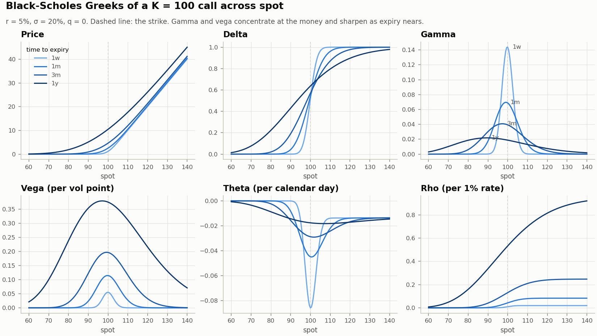
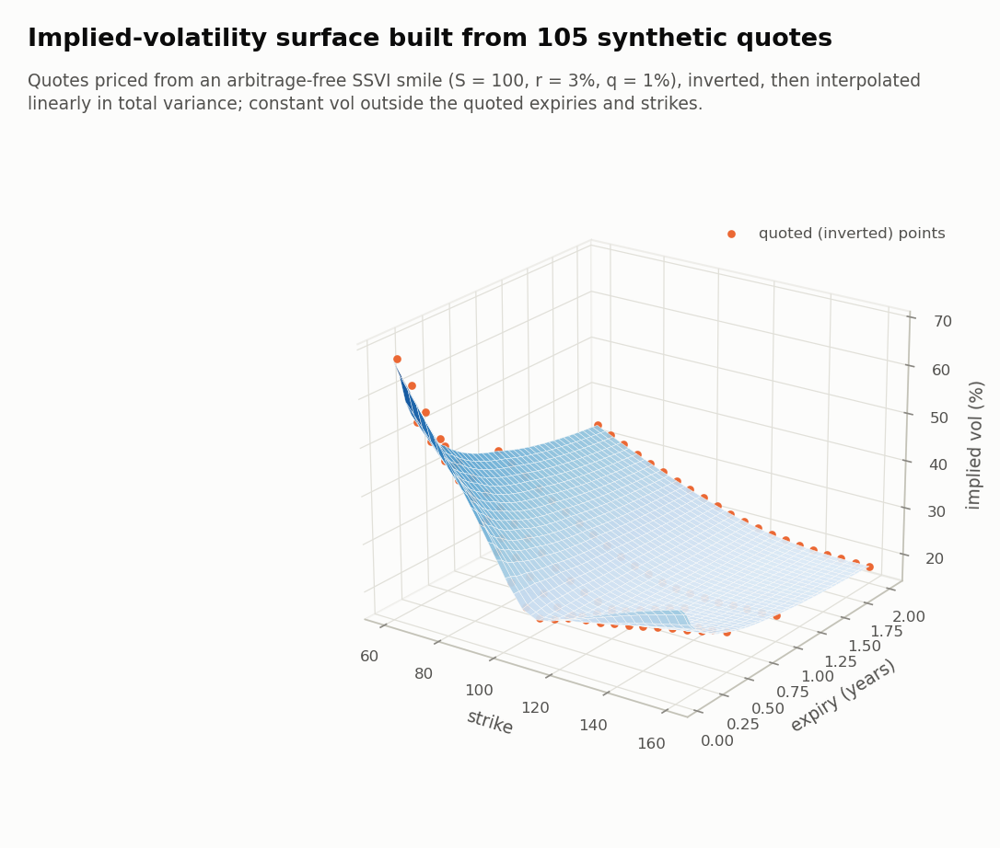
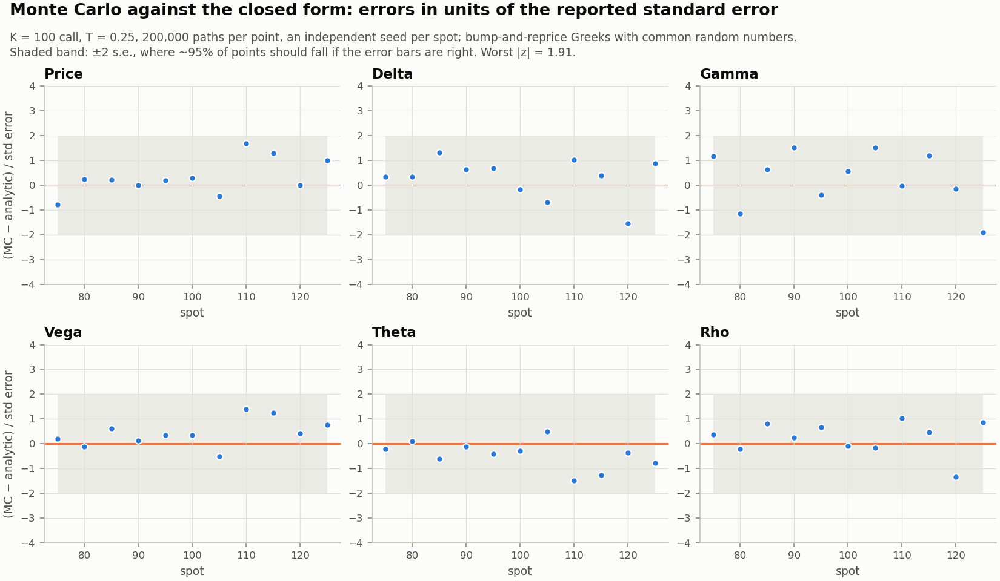
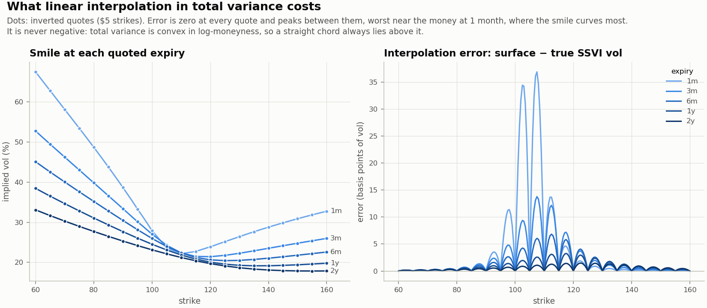
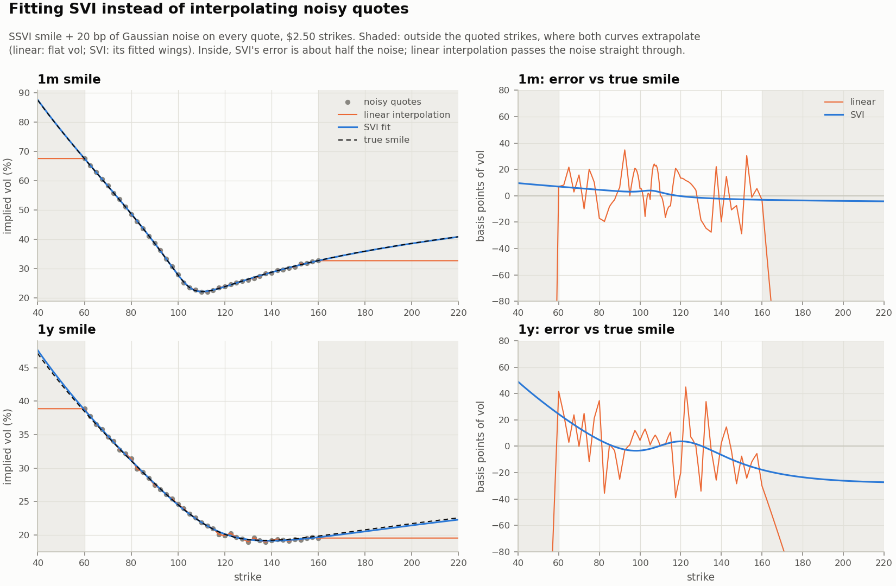

# Options Pricing Engine

[](https://github.com/coreyczhang/options-pricing-engine/actions/workflows/ci.yml)

A European option pricing and Greeks engine in C++17: a **Black-Scholes closed form** with
analytic Greeks, an **implied-volatility solver**, a **vol surface** with an **SVI smile fit**, and a **Monte Carlo** pricer — plain, antithetic, and bump-and-reprice
Greeks with common random numbers — that is validated *against* the closed form. The
emphasis is on correctness you can check: every Monte Carlo number carries a standard
error, the standard error itself is tested, and the variance reduction is measured rather
than asserted.

See **[docs/results.md](docs/results.md)** for the validation write-up and
**[docs/benchmarks.md](docs/benchmarks.md)** for timings.

---

## Scope

**What this is.** A pricing and Greeks engine for European calls and puts under
Black-Scholes-Merton (constant rate, constant volatility, continuous dividend yield), with
two independent implementations that are checked against each other and against published
textbook values.

**What this isn't.**

- **No American or path-dependent options.** European payoffs only; no early exercise, no
  Asians or barriers, so no time-stepping or PDE/lattice methods.
- **No real-data calibration.** The surface interpolates inverted quotes or fits raw SVI
  per expiry (M8). It reports arbitrage rather than repairing it, fits expiries
  independently (no joint SSVI), and has only been validated on synthetic quotes from a
  known smile, not a real option chain.
- **No market data.** Inputs are numbers on the command line or in code; there is no feed,
  no day-count or calendar handling, and no discrete dividends.
- **Not optimized for throughput.** Single-threaded and scalar; see
  [benchmarks.md](docs/benchmarks.md#not-measured).

## Roadmap

| Milestone | Scope | State |
|-----------|-------|-------|
| M1 | Black-Scholes price + analytic Greeks, degenerate cases, reference-value tests | ✅ done |
| M2 | Plain Monte Carlo with standard errors; convergence to BS at 1/√N | ✅ done |
| M3 | Antithetic variates; measured variance reduction across moneyness | ✅ done |
| M4 | Bump-and-reprice MC Greeks with common random numbers vs analytic Greeks | ✅ done |
| M5 | Benchmarks, results write-up, CI | ✅ done |
| M6 | Implied-vol solver: safeguarded Newton, arbitrage-bound handling, conditioning-aware tests | ✅ done |
| M7 | Implied-vol surface from quotes, arbitrage checks, SSVI validation; Greeks and surface plots | ✅ done |
| M8 | Raw-SVI fit per expiry (exact constrained inner LS + 2-D outer search), Durrleman check, SVI smile model on the surface | ✅ done |

**Not done (see [Next steps](docs/results.md#next-steps)):** joint SSVI fit across expiries,
a real option-chain demo, importance sampling for
deep-OTM options, a sharper implied-vol starting guess, pathwise / likelihood-ratio Greeks, control variates, quasi-Monte Carlo,
path-dependent payoffs.

## Build & test

```bash
cmake -S . -B build
cmake --build build
ctest --test-dir build --output-on-failure
```

Requires a C++17 compiler and CMake ≥ 3.14. GoogleTest is fetched automatically via CMake
`FetchContent`. Builds Release by default, with `-Wall -Wextra -Wpedantic` clean.

## Usage

```bash
# pricer <call|put> <spot> <strike> <expiry_years> <rate> <vol> [div_yield]
./build/pricer call 49 50 0.3846 0.05 0.20

# pricer iv <call|put> <spot> <strike> <expiry_years> <rate> <price> [div_yield]
./build/pricer iv call 21 20 0.25 0.10 1.875      # Hull's example: 23.45%

# Regenerate the figures in docs/img (needs numpy + matplotlib: scripts/requirements.txt)
./build/ope_export build/plots && python3 scripts/plot.py build/plots docs/img

# Regenerate every table in docs/ (Release build for meaningful timings)
./build/ope_bench
```

As a library:

```cpp
#include "ope/BlackScholes.hpp"
#include "ope/ImpliedVol.hpp"
#include "ope/MonteCarlo.hpp"
#include "ope/VolSurface.hpp"

const ope::EuropeanOption opt{ope::OptionType::Call, /*strike=*/100.0, /*expiry=*/1.0};
const ope::Market mkt{/*spot=*/100.0, /*rate=*/0.05, /*vol=*/0.20};

double px = ope::bs::price(opt, mkt);                     // 10.450584
ope::Greeks g = ope::bs::greeks(opt, mkt);

auto mc = ope::mc::price(opt, mkt, {1'000'000, /*seed=*/42, /*antithetic=*/true});
// mc.price ± mc.std_error
auto mg = ope::mc::greeks(opt, mkt, {1'000'000});         // mg.value, mg.std_error

ope::iv::Result r = ope::iv::solve(opt, mkt, /*price=*/10.450584);  // r.vol ~ 0.20
// mkt.vol is only the starting guess; r.status flags quotes outside no-arbitrage bounds

ope::surface::VolSurface surf(quotes, /*spot=*/100.0, /*rate=*/0.03, /*div=*/0.01);
double v = surf.vol(/*strike=*/105.0, /*expiry=*/0.75);  // surf.skipped(), surf.arbitrage_violations()
ope::surface::VolSurface smooth(quotes, 100.0, 0.03, 0.01, ope::surface::SmileModel::Svi);
```

## Results at a glance

- **Black-Scholes** matches Hull's and Haug's published prices and Greeks to every printed
  digit; put-call parity holds to 1e-10 and every analytic Greek matches a finite
  difference of the price on a 180-point grid.
- **Plain MC** converges at 1/√N across five orders of magnitude (RMSE × √N ≈ 14.5,
  constant), and its reported std error matches the actual spread of independent runs.
- **Antithetic variates** cut variance **2.0× ATM, 17× deep ITM, 50× for an ITM put, and
  ~1× far OTM** — exactly the pattern VRF = 1/(1 + ρ) predicts — and run ~1.7× faster, so
  the time-adjusted gain is 1.7–86×.
- **MC Greeks** (1M paths) match the analytic Greeks with all |z| ≤ 0.74; CRN keeps
  delta's noise flat as the bump shrinks, while independent seeds are 18× worse at a 1%
  bump and 1,809× worse at 0.01%.
- **Implied vol** recovers σ to ~1e-12 wherever the quote determines it, and otherwise
  returns a σ that reprices the quote to rounding (tested on 2,016 contracts, 1%–300% vol);
  median 5 iterations, 699 ns per solve.
- **Vol surface** reproduces quoted vols to 1e-14 and reports no arbitrage on an
  arbitrage-free SSVI smile, flags injected calendar and butterfly arbitrage, and its
  interpolation error shrinks ~4× per halving of strike spacing (37 bp of vol worst at $5
  strikes; up to 8 vol points when extrapolating before the first expiry).
- **SVI fit** recovers an SVI smile's five parameters to < 1e-6; on quotes with noise its
  residual and error match least-squares theory (0.865 and 0.475 × noise vs 0.873 and
  0.488), halving linear interpolation's error, and it reports no butterfly arbitrage where
  the interpolated noisy smile reports 470 spurious ones.
- **The tests can fail:** a mutation check injects 21 deliberate bugs (wrong drift,
  inflated error bars, broken common random numbers, the same wrong convention in both
  pricers…) and the suite catches all 21; CI enforces it. The first run caught two holes
  in the suite, now fixed.
- **Speed (Apple M3):** closed form 57 ns; MC 35 ns/path plain, 20 ns/path antithetic,
  72 ns/path for all five Greeks.

<p align="center">
  
  
</p>
<p align="center">
  
  
</p>
<p align="center">
  
</p>

## Why these design choices

**Two pricers, one model.** The Monte Carlo engine prices the same GBM model as the closed
form, so any disagreement beyond sampling error is a bug. That turns Black-Scholes from a
feature into a test oracle — the MC machinery (error bars, variance reduction, Greeks) is
what would carry over to payoffs with no closed form.

**Exact terminal sampling, no time-stepping.** A European payoff depends only on S_T, which
is exactly lognormal under GBM, so each path is one normal draw. That removes
discretization bias and leaves sampling error as the *only* MC error — which is what makes
a "within 4 standard errors" test meaningful.

**Every MC result returns its standard error.** A Monte Carlo price without an error bar
can't be checked. The std error is computed over the independent sampling unit — a single
path, or for antithetic the pair average (f(Z) + f(−Z))/2, since the two halves are
correlated. Treating the halves as independent is a classic way to get the error bar wrong.

**Test the error bar, not just the price.** A pricer that under-reports its std error
passes every "within k·se" test for the wrong reason, so the suite also checks calibration:
over 400 independent runs the actual RMS error must match the reported se, and 95%
intervals must cover the truth ~95% of the time.

**Statistical tests that are deterministic but not seed-tuned.** Fixed seeds make every
test pass or fail reproducibly; ~4σ thresholds make a pass meaningful. The thresholds were
then re-checked under thousands of other seeds — which caught one that wasn't safe (see
[results §7](docs/results.md#7-how-the-statistical-tests-stay-deterministic)).

**Own normal transform instead of `std::normal_distribution`.** The standard fixes
`mt19937_64`'s output bit-for-bit but leaves the normal transform to the library, so
libstdc++ and libc++ give different draws from one seed. Box-Muller on top of
`mt19937_64` makes a seed mean the same paths on Linux CI and macOS, so the numbers in the
docs reproduce.

**Separate bump bias from sampling noise.** A finite-difference Greek has O(h²) bias *and*
MC noise. Testing MC against the analytic Greek with one loose tolerance blurs the two, so
MC is tested tightly against the *same finite difference of the BS price* (pure noise), and
that finite difference is tested against the analytic Greek (pure bias).

**Common random numbers inside the path loop.** Each bumped payoff is evaluated on the same
draw as the base payoff, and the Greek is the mean of per-path differences. This keeps
delta's noise independent of the bump size (independent seeds make it grow as 1/h) and
gives each Greek its own std error from one pass.

**Degenerate inputs return the exact limit.** At T = 0 or σ = 0 the BS formula divides by
zero; instead the engine returns the discounted forward intrinsic value, which is the
formula's limit, and tests that the general formula converges to it smoothly.

**Implied vol: bracketed Newton, statuses not exceptions, accuracy judged by conditioning.**
Newton with the analytic vega is quadratic near the root but can diverge or crawl on the
flat tails, so it runs inside a bracket and bisects whenever a step leaves it or fails to
halve the last one — convergence is guaranteed, not hoped for. Quotes outside the
no-arbitrage bounds are returned as a status because real chains contain them and a surface
builder must skip, not abort. And the round-trip test doesn't demand 1e-12 everywhere —
that is unattainable when many vols reprice a quote identically to rounding — it demands
that every solve reprice the quote to within noise, and that σ be recovered tightly
wherever the price actually determines it.

**Vol surface: interpolate in total variance, keep OTM quotes, validate on a known smile.**
Total variance against log-moneyness is the coordinate system where no-arbitrage
conditions are simplest — calendar arbitrage is just w falling with T — so interpolating
there keeps a calendar-free set of slices calendar-free. OTM quotes are all time value and
invert with the best conditioning. And with no market data, the honest test is a round
trip through a smile whose answer is known (SSVI), measuring the interpolation error
instead of eyeballing a pretty surface.

**SVI: solve the linear part exactly, search only the nonlinear part.** Throwing all five
SVI parameters at a generic optimizer invites local minima. For fixed (m, σ) the rest is a
constrained linear least squares, small enough (3 variables, 6 constraints) to solve
exactly by enumerating active sets, so the search is only 2-dimensional. The constraints
are the ones that keep wings sane (Lee's bound) — and since they don't guarantee a
non-negative density, every fit is also checked with Durrleman's condition. The test that
matters is statistical: residuals on noisy quotes match least-squares theory, which a fit
stuck in a local minimum would not.

**Prove the tests can fail.** Agreement between two pricers is only evidence if a bug would
break it. `scripts/mutation_check.py` injects bugs one at a time and checks that some test
fails. The most informative mutants put the *same* wrong convention into both pricers:
Monte Carlo still agrees with Black-Scholes, so only checks that don't go through Monte
Carlo — published reference values, put-call parity — can catch them, and they do
([results §11](docs/results.md#11-can-the-tests-fail-a-mutation-check)).

**Plots in Python, numbers in C++.** The library stays dependency-free; `ope_export`
writes CSVs and a short matplotlib script draws them, so every figure traces back to
engine output.

**Numerics where they matter.** N(x) uses `erfc`, not `1 + erf`, so far-OTM prices keep
precision instead of rounding to 0; variance uses Welford's one-pass algorithm instead of
Σx² − n·x̄², which cancels catastrophically when the spread is small relative to the level.

## Known limitations

- **Rare events break plain MC's error bar.** A put ~4.7σ out of the money pays on about
  one path in a million; at 200k paths none hit and MC reports **0 ± 0**. This is pinned
  down by a test rather than hidden. Fix: importance sampling (not implemented).
- **Bump-and-reprice gamma is noisy.** Its variance grows like 1/h, so gamma needs a
  coarser bump than delta (bias vs noise in [results §5](docs/results.md#5-bump-size-bias-vs-noise-and-why-common-random-numbers)).
  Default bumps are shared across Greeks; at 1M paths delta's 1%-bump bias is ~0.15 se,
  so for much higher path counts delta should use a smaller bump.
- **Surface extrapolation is a guess.** Outside the quoted strikes and expiries the
  surface holds vol constant; on the SSVI test that is off by up to 8 vol points on the
  deep wing before the first expiry (0.2 points at the money). Between expiries, linear interpolation in T is off by up to 1.1 vol
  points between 1m and 3m.
- **SVI fits each expiry alone.** Fitted slices can cross (calendar arbitrage); this is
  checked and reported, not prevented. On synthetic SSVI quotes the fit is exact because
  the truth is SVI — real smiles would add model error.
- **Model risk is out of scope.** Everything is validated *within* Black-Scholes; nothing
  here says the model is right for any real market.
- **Timings are from one machine** and single-threaded.

## Layout

```
include/ope/   Option.hpp (types, payoff, validation), BlackScholes.hpp,
               ImpliedVol.hpp, VolSurface.hpp, Svi.hpp, MonteCarlo.hpp, NormalRng.hpp
src/           Option.cpp, BlackScholes.cpp, ImpliedVol.cpp, VolSurface.cpp, Svi.cpp,
               MonteCarlo.cpp,
               main.cpp (pricer CLI), bench_main.cpp (ope_bench), export_main.cpp (ope_export)
tests/         test_black_scholes.cpp, test_implied_vol.cpp, test_vol_surface.cpp,
               test_svi.cpp, test_monte_carlo.cpp, test_mc_greeks.cpp
scripts/       plot.py (figures from ope_export's CSVs), requirements.txt,
               mutation_check.py (injects bugs, checks the suite catches them)
docs/          results.md, benchmarks.md, img/ (figures)
```

## License

MIT — see [LICENSE](LICENSE).
