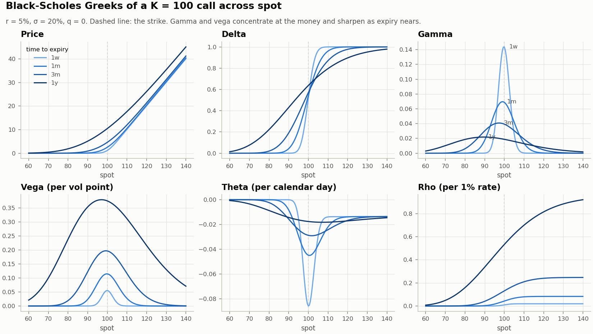
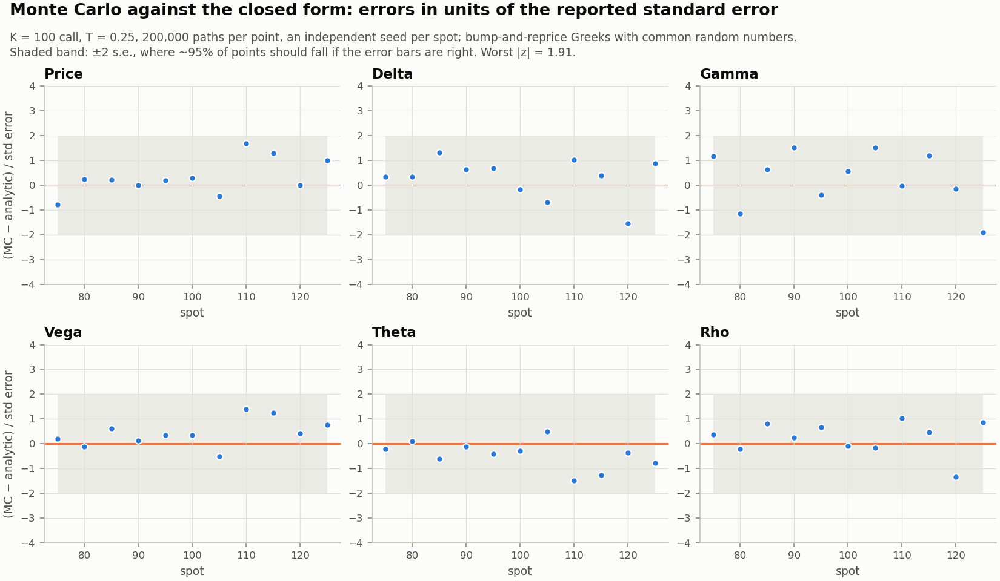
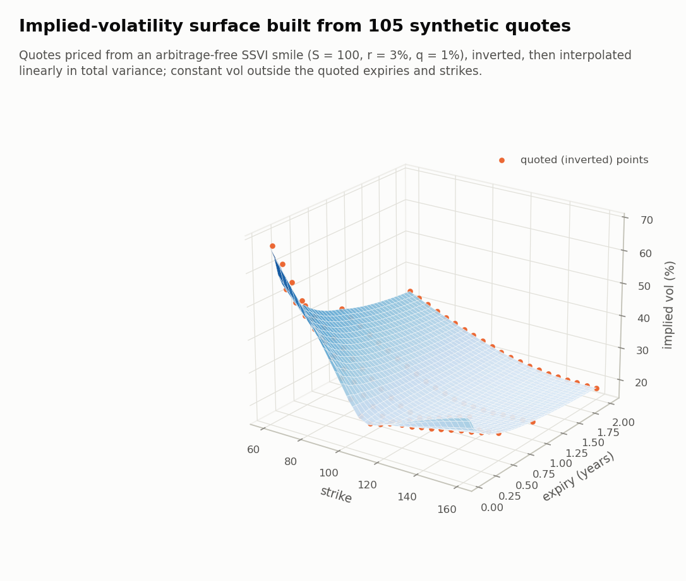
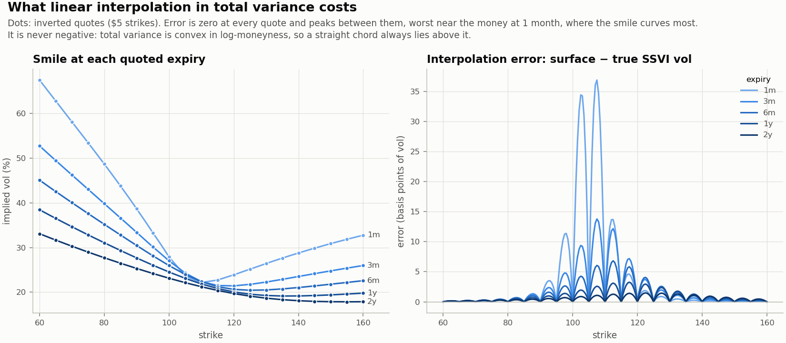
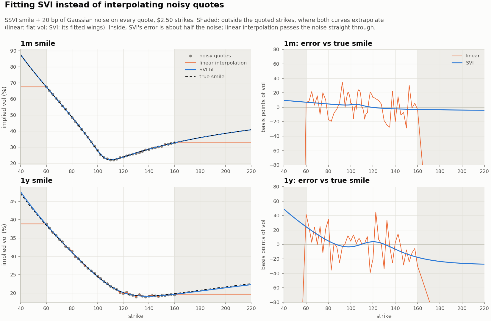

# Validation Results

Every table below is printed by `ope_bench` (except §1, which is from `pricer` and the
test suite) and pasted unedited; rerun it to regenerate them:

```bash
cmake -S . -B build -DCMAKE_BUILD_TYPE=Release && cmake --build build
./build/ope_bench
```

Unless stated otherwise the reference contract is an **ATM European call: S = 100, K = 100,
T = 1y, r = 5%, σ = 20%, q = 0**, Black-Scholes price **10.450584**. Monte Carlo runs use
the exact lognormal terminal draw (no time-stepping), so the only MC error is sampling
error. Seeds are fixed; the RNG is `mt19937_64` + our own Box-Muller, so a seed means the
same paths on Linux and macOS.

## 1. Black-Scholes against published values

| Source | Contract | Published | This engine |
|---|---|---:|---:|
| Hull, BSM chapter example | call S=42 K=40 r=10% σ=20% T=0.5 | 4.76 | 4.759422 |
| | put, same | 0.81 | 0.808599 |
| Haug, generalized BSM example | call S=60 K=65 r=b=8% σ=30% T=0.25 | 2.1334 | 2.133368 |
| Haug, Merton (1973) dividend example | put S=100 K=95 r=10% q=5% σ=20% T=0.5 | 2.4648 | 2.464788 |
| Hull, "Greek letters" example (20-week call, S=49 K=50 r=5% σ=20%) | price | ≈2.40 | 2.400527 |
| | delta | 0.522 | 0.521605 |
| | gamma | 0.066 | 0.065544 |
| | vega (per 1.00 vol) | 12.1 | 12.105480 |
| | theta (per year) | −4.31 | −4.305330 |
| | rho (per 1.00 rate) | 8.91 | 8.906962 |

Every value agrees to the precision the source prints. Beyond these spot checks the test
suite verifies, on a 180-point grid (ITM/ATM/OTM, T from 0.05 to 2y, σ from 5% to 80%,
with and without rates and dividends): put-call parity to 1e-10, static no-arbitrage
bounds, Greek parity relations, and **every analytic Greek against a central finite
difference of the analytic price** — an independent check that catches a wrong sign or a
missing term in a Greek formula.

## 2. Plain Monte Carlo converges to Black-Scholes

| paths | MC price (seed 42) | std error | MC - BS | (MC - BS) / se | RMSE over runs | runs | RMSE x sqrt(N) |
|------:|------:|------:|------:|------:|------:|------:|------:|
| 100 | 9.100140 | 1.181609 | -1.350443 | -1.14 | 1.471632 | 200 | 14.716 |
| 1000 | 10.117523 | 0.433487 | -0.333060 | -0.77 | 0.447845 | 200 | 14.162 |
| 10000 | 10.323103 | 0.145967 | -0.127481 | -0.87 | 0.141440 | 200 | 14.144 |
| 100000 | 10.397135 | 0.046227 | -0.053449 | -1.16 | 0.047037 | 200 | 14.874 |
| 1000000 | 10.441925 | 0.014695 | -0.008659 | -0.59 | 0.014184 | 50 | 14.184 |
| 10000000 | 10.455111 | 0.004657 | +0.004528 | +0.97 | - | - | - |

**Reading it.** The last column is the convergence check: if error ∝ 1/√N, RMSE × √N is
constant (at the discounted payoff's standard deviation, ≈ 14.5 here). It holds across
five orders of magnitude. Each extra decimal digit costs 100× the paths.

The single-seed errors are all negative up to 1M paths. That is **not bias**: every row
reuses seed 42, so the 1,000-path run starts with the 100-path run's paths and their errors
are correlated row to row. The RMSE column uses independent seeds for exactly this reason.

**The error bar is checked, not assumed.** A pricer that under-reports its std error would
pass every "within 4 se" test for the wrong reason, so the tests also run 400 independent
pricings and check that the average is unbiased, that the actual RMS error matches the
reported se to within 15%, and that 95% intervals cover the true price ~380/400 times.

## 3. Antithetic variates: measured variance reduction

1,000,000 payoff evaluations per estimate (antithetic = 500,000 pairs Z, −Z), seed 42.
VRF = (se_plain / se_anti)² at **equal payoff evaluations**; implied ρ = corr(f(Z), f(−Z))
= 1/VRF − 1. Efficiency = VRF × t_plain / t_anti, i.e. variance reduction per unit of CPU
time.

| contract | BS | plain (± se) | antithetic (± se) | VRF | implied rho | t plain (ms) | t anti (ms) | efficiency |
|---|---:|---:|---:|---:|---:|---:|---:|---:|
| call K=70 (deep ITM) | 33.5401 | 33.5248 ± 0.0199 | 33.5346 ± 0.0048 | 17.36 | -0.942 | 35.5 | 20.5 | 30.10 |
| call K=85 | 20.4693 | 20.4558 ± 0.0184 | 20.4616 ± 0.0076 | 5.87 | -0.830 | 35.5 | 20.5 | 10.16 |
| call K=100 (ATM) | 10.4506 | 10.4419 ± 0.0147 | 10.4439 ± 0.0104 | 2.01 | -0.501 | 35.3 | 20.4 | 3.46 |
| call K=115 | 4.4666 | 4.4593 ± 0.0101 | 4.4602 ± 0.0090 | 1.24 | -0.194 | 35.4 | 20.4 | 2.15 |
| call K=130 | 1.6396 | 1.6318 ± 0.0061 | 1.6312 ± 0.0059 | 1.07 | -0.067 | 35.4 | 20.4 | 1.85 |
| call K=160 (far OTM) | 0.1590 | 0.1556 ± 0.0018 | 0.1576 ± 0.0019 | 0.98 | +0.022 | 35.5 | 20.4 | 1.70 |
| put K=100 (ATM) | 5.5735 | 5.5790 ± 0.0087 | 5.5707 ± 0.0066 | 1.71 | -0.416 | 35.1 | 20.5 | 2.92 |
| put K=130 (ITM) | 25.2994 | 25.3058 ± 0.0169 | 25.2948 ± 0.0024 | 50.25 | -0.980 | 35.1 | 20.4 | 86.28 |

Cross-check, ATM call, 10,000 paths: VRF from reported se = 2.02; VRF from the actual RMSE
over 2,000 independent seeds = 1.91 (each MSE is known to ~±3% at 2,000 runs, so the
ratio to ~±4.5%).

**One formula explains the table.** The pair average has variance Var(f)(1 + ρ)/2, so at
equal work VRF = 1/(1 + ρ):

- **Deep ITM**, a call is nearly linear in S_T, so f(Z) and f(−Z) move almost exactly
  opposite: ρ → −1, VRF 17–50×.
- **ATM**, the payoff is linear on one side of the kink and flat on the other: ρ ≈ −0.5,
  VRF ≈ 2.
- **Far OTM**, Z and −Z almost never both pay: ρ ≈ 0, VRF ≈ 1. Theory says ρ = −μ²/σ² ≈
  −0.008 here (VRF ≈ 1.01); the measured 0.98 is estimation noise — over 20 seeds the VRF
  averaged 1.001 (range 0.95–1.03).

For any monotone payoff (a vanilla call or put) ρ ≤ 0, so antithetic never hurts. A
symmetric payoff such as a straddle would have ρ > 0 and antithetic would *increase*
variance — stated from theory, not measured (the engine prices calls and puts only).

**Antithetic is also ~1.7× faster** at equal payoff evaluations: it does half as many
normal draws and accumulator updates, and that per-unit work costs more than the exp and
the payoff (≈ 30 ns vs ≈ 5.5 ns; see [benchmarks.md](benchmarks.md)). That is why
efficiency exceeds VRF on every row, even the far-OTM call.

**The std error is computed over pairs.** The independent unit is (f(Z) + f(−Z))/2, not
each half; the calibration test from §2 is run for both modes. Over 4,000 independent
seeds, actual MSE / mean reported se² = 1.001 (antithetic) and 0.990 (plain).

## 4. Monte Carlo Greeks against analytic Greeks

1,000,000 paths, seed 42. Bump-and-reprice with **common random numbers**: every bumped
payoff is evaluated on the same draw Z as the base payoff, and each Greek is the sample
mean of the per-path finite differences, which also gives it a std error. Default bumps:
spot 1% of S, vol 0.001, expiry 1 day, rate 1 bp.

Two error sources are reported separately:

- **bump bias** = (Black-Scholes finite difference with the same bumps) − (analytic
  Greek). Deterministic; no Monte Carlo involved.
- **z** = (MC − BS finite difference) / se. Pure sampling noise, should look like N(0, 1).

**ATM call** (all five Greeks in one pass: 71 ms)

| Greek | analytic | bump bias | MC (± se) | rel. se | z |
|---|---:|---:|---:|---:|---:|
| delta | 0.63683 | -8.6e-05 | 0.63649 ± 0.00057 | 0.09% | -0.44 |
| gamma | 0.01876 | -2.3e-06 | 0.01870 ± 0.00011 | 0.57% | -0.57 |
| vega | 37.52403 | -3.0e-05 | 37.47228 ± 0.07548 | 0.20% | -0.69 |
| theta | -6.41403 | -3.7e-06 | -6.40786 ± 0.00885 | 0.14% | +0.70 |
| rho | 53.23248 | -7.7e-07 | 53.21212 ± 0.04722 | 0.09% | -0.43 |

**ATM put** (all five Greeks in one pass: 71 ms)

| Greek | analytic | bump bias | MC (± se) | rel. se | z |
|---|---:|---:|---:|---:|---:|
| delta | -0.36317 | -8.6e-05 | -0.36337 ± 0.00041 | 0.11% | -0.28 |
| gamma | 0.01876 | -2.3e-06 | 0.01870 ± 0.00011 | 0.57% | -0.57 |
| vega | 37.52403 | -3.0e-05 | 37.55537 ± 0.04775 | 0.13% | +0.66 |
| theta | -1.65788 | -3.7e-06 | -1.66002 ± 0.00290 | 0.17% | -0.74 |
| rho | -41.89046 | -9.3e-07 | -41.91082 ± 0.04722 | 0.11% | -0.43 |

All ten |z| ≤ 0.74. The bump bias is below the 1M-path sampling error for every Greek, but
by very different margins: bias / se ≈ 0.15 for delta, 0.02 for gamma, 4e-4 for vega and
theta, 2e-5 for rho. Delta is the tight one — a 1% spot bump still picks up delta's
curvature — so its bias would become visible at roughly 50× more paths (se shrinks √50 ≈
7×). For high-precision delta, shrink `Bumps::spot_rel`: with CRN this costs nothing in
delta noise (§5), only in gamma noise, so in practice delta and gamma would use different
bumps. Call and put gamma agree to every digit because C − P = S·e^{−qT} − K·e^{−rT}
holds *path by path*: the payoffs differ by a linear function of S_T, whose second
difference is zero on every draw.

## 5. Bump size: bias vs. noise, and why common random numbers

ATM call, 200,000 paths. "Independent" = the up and down prices repriced with different
seeds, se = √(se_up² + se_dn²) / 2h.

| spot bump h | delta se (CRN) | delta se (independent) | ratio | gamma (CRN, ± se) | gamma rel. se | gamma bump bias |
|---:|---:|---:|---:|---:|---:|---:|
| 10% | 0.00117 | 0.00240 | 2x | 0.01853 ± 0.00006 | 0.3% | -2.3e-04 |
| 3% | 0.00125 | 0.00779 | 6x | 0.01871 ± 0.00013 | 0.7% | -2.1e-05 |
| 1% | 0.00128 | 0.02330 | 18x | 0.01904 ± 0.00024 | 1.3% | -2.3e-06 |
| 0.1% | 0.00129 | 0.23289 | 181x | 0.01974 ± 0.00079 | 4.2% | -2.3e-08 |
| 0.01% | 0.00129 | 2.32893 | 1809x | 0.02235 ± 0.00267 | 14.2% | -1.9e-11 |

- **Delta, independent seeds:** both prices' full noise survives into (V_up − V_dn)/2h,
  so the std error grows as 1/h — 1,809× worse than CRN at a 0.01% bump.
- **Delta, CRN:** the per-path difference is bounded (the payoff is Lipschitz in S), so
  the noise is flat in h and small bumps are free. At h = 1% the predicted ratio is
  √2·sd(payoff)/(2h) ÷ sd(per-path delta) ≈ 10.3 / 0.55 ≈ 18.5; measured 18.
- **Gamma, even with CRN:** the second difference is nonzero only on paths ending within
  ~h of the strike, where it is ~1/h, so variance ∝ 1/h and se ∝ 1/√h (0.3% → 14% as h
  shrinks 1000×), while the O(h²) bias falls 10⁷×. At 10% bias dominates (1.2% bias vs
  0.3% noise); below ~0.1% noise dominates. The 1% default sits between. Pathwise or
  likelihood-ratio estimators avoid this; they are out of scope for v1.

## 6. Known limitation: rare events

A put ~4.7 standard deviations out of the money (S=100, K=80, T=0.1, σ=15%) has a true
price of 6.2e-7 — roughly one path in a million pays. With 200,000 paths, none did, and
plain MC returned **0 ± 0**: wrong, with an error bar claiming certainty. The CLT-based std
error only means something once enough paths land where the payoff is nonzero. This is
pinned down by a test (`MonteCarloLimitation.FarOtmWithNoHitsReportsZeroPlusMinusZero`)
rather than hidden; the standard fix is importance sampling (shift the drift toward the
strike and reweight), which is not implemented.

## 7. How the statistical tests stay deterministic

Every MC test uses a fixed seed, so it passes or fails deterministically, with thresholds
at ~4 standard errors so they do not depend on a lucky seed. That claim was checked by
re-running each statistical check under thousands of other seeds (agreement within 4 se:
0/700 plain, 0/700 antithetic, 0/2,400 Greek checks; std-error calibration: 0/100 blocks
per mode; convergence-rate and CRN/gamma scaling checks: 0/200 and 0/100). The sweep also
caught a threshold that was *not* safe: "antithetic VRF > 0.9 for monotone payoffs" failed
1.5% of seeds at 200k paths on a short-dated OTM put, whose rare, heavy-tailed payoff makes
the VRF estimate noisy (sd ≈ 0.05). That test now uses 2M paths (sd ≈ 0.016; minimum over
100 seeds 0.970).

One seed deserves a note: seed 7, used by several MC tests, has a first-200k-draw mean of
+3.95 standard errors. The tests using it still pass and their thresholds were validated
under hundreds of other seeds, but its results sit near the edge of the ~4σ thresholds;
§9 has how it showed up.

## 8. Implied volatility: inverting Black-Scholes

`ope::iv::solve` finds the σ at which the BS price equals a quote. The BS price is strictly
increasing in σ, running from the no-arbitrage lower bound (forward intrinsic) at σ = 0 to
the upper bound (S e^(−qT) for a call, K e^(−rT) for a put) as σ → ∞, so any quote strictly
inside has exactly one implied vol; quotes on or outside the bounds come back as a status,
not an exception, because a surface builder will meet them and needs to skip them.

The method is Newton on σ with the analytic vega, kept inside a bracket that always holds
the root, falling back to bisection when a Newton step would leave the bracket *or* fails to
halve the previous step. The first version had only the first rule, and on the 2,016-contract
grid below **74 solves hit 100 iterations without converging**: on the flat tails of the
price curve Newton stayed inside the bracket while crawling. The second rule (the classic
`rtsafe` safeguard) fixed all 74; max is now 29.

The stopping rule took three tries, and CI on Linux caught the first two. The solver stops
once the price residual is indistinguishable from rounding noise in `bs::price`. That noise
is about ε × (|S e^(−qT) N(±d1)| + |K e^(−rT) N(±d2)|), because the price is a difference of
those two terms, and it can be far larger than ε × price whenever they nearly cancel (deep
in the money, or near the forward at low vol). Version 1 scaled the noise by the price;
version 2 by price + 2 × intrinsic. Each underestimated it somewhere, so those solves
bisected on noise down to `vol_tol`. The answers were still right, but the iteration count
depended on the last bits of the platform's `exp`/`erfc`: **44 iterations on Linux/glibc
vs 30 on macOS**, which failed the iteration test there. Version 3 uses the term magnitudes
directly (they sum to |V − 2·S·delta|, free from the Greeks already computed per step).
Building locally with `-ffp-contract=off` (no fused multiply-add, closer to GCC on x86)
reproduced a failure, and the fix passes under both builds and on Linux CI.

Round trip — price at a known σ, solve from the automatic start, compare — on 2,016
contracts (vol 1%–300%, moneyness 0.5–2, 1 day–5 years, call/put, q = 0/3%), bucketed by how
much the quote pins down σ (vega / price):

| bucket | contracts | median iters | p95 iters | max iters | worst vol error |
|---|---:|---:|---:|---:|---:|
| vega/price >= 1e-2 (well conditioned) | 1498 | 5 | 19 | 29 | 4.2e-13 |
| 1e-6 <= vega/price < 1e-2 | 117 | 7 | 14 | 16 | 1.4e-08 |
| vega/price < 1e-6 (time value ~ rounding) | 43 | 11 | 15 | 15 | 4.1e-03 |

358 more quotes sit exactly on the intrinsic bound once rounded (deep-ITM time value below a
few ulps of the strike, or a far-OTM price that underflows to 0). They are reported as
`AtLowerBound` with vol 0, since the quote carries no information about σ.

**Reading this honestly:**

- **Accuracy is limited by the quote, not the solver.** Every σ whose price lies within
  rounding noise of the quote is an equally valid answer, and that set can be wide: a
  one-week put 50% in the money prices identically to rounding for every vol from 0.24 to
  0.40, which is the 4e-3 worst case above. So the round-trip test
  (`ReproducesThePriceAndRecoversVolWhereThePriceDeterminesIt`) checks two things: every
  solve reprices the quote to within noise, and the vol itself is recovered to 1e-9 wherever
  noise / vega — the width of that set — is below 1e-12. An earlier version of the test
  bounded the vol error by noise / vega at the *true* vol; that linearization fails exactly
  where vega collapses between the true vol and the answer, as in the put above.
- **Tiny OTM prices are not treated as zero.** The tolerance band around intrinsic applies
  only in the money, where intrinsic is a difference of large numbers. Out of the money the
  bound is exactly 0 and `erfc` keeps tiny prices accurate, so a 1-week, 5%-OTM call at 1%
  vol priced at **4e-264** solves back to 1% within 1e-12. The first version swallowed such
  quotes into the band; a test now pins this down.
- **The starting guess is the weak point.** The automatic start is the vol where vega peaks
  (Manaster–Koehler), which is safe but far from low-vol answers away from the money: ~0.94
  for a 10%-OTM, 3-month option. That is where the p95 of 19 iterations in the
  well-conditioned bucket comes from; near the money it is 4. The answer never depends on
  the start (tested with starts from 1e-4 to 9.0).
- **Cost:** 699 ns per solve, 4.6 iterations on average for 1-year calls with strikes 80–120
  and true vol 10%–46% (benchmarks.md) — about 5 price + vega evaluations.

## 9. Implied-vol surface and plots

`ope::surface::VolSurface` builds a surface from a set of quotes: invert each with §8's
solver, keep the out-of-the-money quote at each strike/expiry (all time value, so the
best-conditioned; the ITM quote is used only if the OTM one is missing or fails), and
interpolate **linearly in total variance w = σ²T against log-moneyness k = ln(K/F)**, both
within an expiry and across expiries, with constant vol outside the quoted range. Bad
quotes (below intrinsic, above the upper bound, zero bid, duplicates, invalid) are recorded
with a reason rather than thrown. It also checks the quoted nodes for static arbitrage:
calendar (w falling with expiry at fixed k) and butterfly (call prices not decreasing and
convex in strike).

**It interpolates; it does not fit.** Noisy quotes give a noisy surface, and arbitrage in
the quotes is reported, not repaired. Fitting a parametric smile (SVI) is the next step.

**Validation against a known smile.** There is no market data here, so the tests generate
quotes from **SSVI** (Gatheral & Jacquier 2014) with parameters that make it provably free
of static arbitrage (η(1 + |ρ|) ≤ 2, increasing ATM variance), invert them, and compare the
surface to the smile they came from. Strikes 60–160, expiries 1m/3m/6m/1y/2y:

| check | result |
|---|---|
| vol at the quoted points vs SSVI | error ≤ 1e-14 |
| arbitrage violations reported on SSVI quotes | 0 (at $20, $5 and $1.25 strike spacing) |
| worst mid-strike error, $5 / $2.50 / $1.25 spacing | 3.7e-3 / 1.07e-3 / 2.8e-4 vol: ~4× per halving, the O(h²) of linear interpolation |
| error between expiries, 2 / 3 / 5 expiries in [0.5, 1] | 2.8e-3 / 1.0e-3 / 3.2e-4 |
| a slice quoted at 10% vol behind a 21% one | flagged as calendar arbitrage |
| one strike's vol spiked to 35% | flagged as butterfly arbitrage at that strike |
| junk quotes added to a clean chain | surface unchanged bit-for-bit; each skip has the right reason |

**Where the interpolation error goes**, at $5 strikes (from the `ope_export` grid; see the
figure below):

- **At the quoted expiries: 0 to +37 bp of vol**, zero at every quote and peaking between
  them near the money at 1 month, where the smile curves most. It is never negative: total
  variance is convex in log-moneyness, so the straight chord between two quotes lies above it.
- **Between quoted expiries: −111 to +33 bp**, worst between 1m and 3m (−43 bp or better
  beyond 3m). Linear interpolation in T at fixed k misses the curvature of the ATM variance
  term structure, which is steepest at the short end.
- **Before the first expiry: up to −8.3 vol points**, on the deep downside wing (K = 60 at
  T = 0.05: 67.5% on the surface vs 75.8% true). SSVI's smile keeps steepening as expiry
  shrinks, which constant-vol extrapolation can't know; at the money the miss is only 0.23
  points (27.84% vs 28.07%). Anything outside the quoted expiries is an assumption, not a
  measurement.

### Figures

Generated by `ope_export` (C++, the numbers) and `scripts/plot.py` (matplotlib, the
drawing):

```bash
./build/ope_export build/plots && python3 scripts/plot.py build/plots docs/img
```





The MC figure plots errors in units of each point's own standard error, with an
independent seed per spot. An earlier version used one seed (7) for every spot, and every
point sat ~3 se high in the same direction: seed 7's first 200,000 normal draws happen to
average +3.95 standard errors, a ~1-in-10,000 stream. Nothing was wrong with the estimator
(other seeds give −0.96, −0.12, −1.66, and the calibration test of §7 passes), but one draw
shown eleven times looks like a bias. With independent seeds the worst |z| is 1.91.





## 10. Fitting SVI instead of interpolating

§9's surface passes through every quote, so it passes their noise straight through, and
outside the quoted strikes it can only hold vol flat. `ope::svi::fit` fits **raw SVI**
per expiry, w(k) = a + b(ρ(k − m) + √((k − m)² + σ²)), and `VolSurface` uses it with
`SmileModel::Svi` (interpolation across expiries is unchanged).

**Method.** For fixed (m, σ) the other three parameters enter linearly (Zeliade / De Marco
& Martini), so the inner fit is a 3-variable least squares over a polytope: a ≥ 0,
|ρ| ≤ 1, and Lee's wing bound b(1 + |ρ|) ≤ 2. It is solved exactly by enumerating active
constraint sets (a convex QP's optimum is the equality-constrained optimum of one of them).
The outer problem over (m, ln σ) is 2-dimensional: a 41 × 25 grid, then Nelder–Mead.
Weights 1/w make the objective approximately squared error in vol. A fit takes 10.7 ms per
21-strike expiry (`ope_bench`).

**Validation:**

| check | result |
|---|---|
| quotes from an SSVI slice (exactly SVI, known parameters), 5 expiries | all five parameters recovered to < 1e-6; fit within 3e-9 vol of the quotes |
| 20 bp noise, 60 draws: residual vs quotes | 0.865 × noise (least-squares theory with 5 of 21 degrees of freedom used: 0.873) |
| same: error vs the true smile, at the quotes | 0.475 × noise (theory: √(5/21) = 0.488); linear interpolation's is 1.0 × |
| 20 bp noise on $2.50 strikes, 10 draws: butterfly arbitrage reported | linear smile **470** (all noise), SVI **0** |
| Durrleman's condition on 1,200 noisy fits (5–50 bp, 1m and 1y) | never violated |
| Vogt's raw-SVI example (Gatheral & Jacquier 2014) | flagged: min g = −0.033 at k = 0.88 |
| data with wing slope 3 (beyond Lee's 2) | fit stops exactly at the bound |

The residual matching theory is the useful check on the optimizer: a fit stuck in a local
minimum leaves residuals larger than σ√((n − p)/n), and across 60 draws it doesn't.



**Reading this honestly:**

- **The no-noise results are a best case.** The quotes come from SSVI, which *is* SVI, so
  the fit can be exact, including in the wings. Real smiles are not exactly SVI; on real
  quotes the fit's residual would include model error as well as noise.
- **Extrapolation is better, not solved.** Beyond the quoted strikes SVI extends its fitted
  wings instead of holding vol flat. In the figure that is −27 bp at K = 220 on the 1-year
  smile with 20 bp noise (flat extrapolation: 19.5% vs a true 22.5%, a 3.0-point miss), but the wings
  are estimated from the outermost quotes and inherit their noise.
- **The error is smaller but correlated.** Linear interpolation's error is the noise at
  each quote; SVI's is about half as large but smooth, so it moves neighbouring strikes
  together. A fitted smile can be wrong in a consistent direction across a region.
- **Each expiry is fitted alone.** Nothing forces fitted slices not to cross; `VolSurface`
  checks for calendar arbitrage on a k-grid and reports it, but does not prevent it. A
  joint SSVI fit across expiries would be calendar-free by construction.
- **a ≥ 0 is a restriction.** It keeps the inner problem convex and w positive, but rules
  out some valid smiles with a < 0.

## 11. Can the tests fail? A mutation check

Agreement between two pricers only means something if a bug would break it. So
`scripts/mutation_check.py` injects deliberate bugs, one at a time, into a scratch copy of
the repository, rebuilds, runs the full suite, and records which tests fail. CI runs it on
every push and fails if any mutant survives.

| mutant group | examples | caught by MC-vs-BS agreement? | what catches it |
|---|---|---|---|
| Monte Carlo pricer only | drift without the −σ²/2 Itô term, drift without q, discount at r − q, normals with variance ½ | **yes** | agreement, plus the convergence and calibration tests |
| the error bar | std error 2× too large or ½ too small; antithetic error over the halves; every normal drawn twice | **no** for 3 of 4 | the calibration test (§2); the 2×-too-large bar makes agreement *easier* to pass |
| antithetic pairing | pair evaluates f(Z) twice instead of f(Z), f(−Z) | no (it is unbiased) | the variance-reduction tests (§3) |
| Monte Carlo Greeks | delta over h not 2h, theta sign, common random numbers broken for delta/vega/theta/rho | for the biased ones | bias: agreement with the BS finite difference; broken CRN: noise-scaling tests (§5) |
| Black-Scholes only | N(d1)/N(d2) swapped, wrong sign on σ√T/2 | yes | Hull/Haug reference values, put-call parity, and agreement |
| **shared: the same wrong convention in both pricers** | both ignore dividends; both skip discounting; both grow the stock at r + q | **no — 0 agreement failures in all three** | Hull/Haug reference values, put-call parity with an explicit S e^(−qT), the zero-vol forward limit |

**Two mutants survived the first run**, and each exposed a real hole:

- **Vega with common random numbers broken** (down-bump evaluated on −Z). The estimate stays
  unbiased, so every agreement test passed; only its noise is wrong, and the noise-scaling
  tests covered delta and gamma only. Theta and rho had the same hole. Fixed by
  `McGreeksCrn.VegaThetaRhoNoiseStaysBoundedAsBumpsShrink`: with CRN their std errors stay
  flat when the bumps shrink 10×; without, they grow ~10×.
- **Variance divided by n instead of n − 1.** A 1/(2n) change, about 2.5e-6 at 200k paths:
  no statistical test can resolve it. Fixed by a deterministic test,
  `MonteCarlo.PriceAndStdErrorAreTheSampleStatisticsOfTheDiscountedPayoffs`, that recomputes
  5- and 10-path runs by hand from the same draws, where the difference is 11%.

After those two tests, **21 of 21 mutants are caught**.

**What this shows and what it doesn't.** The shared mutants are the important result:
Monte Carlo agreeing with Black-Scholes cannot detect a convention both get wrong, and in
all three cases not one agreement test failed. They are caught only because Black-Scholes
is also pinned to published numbers and identities that don't go through Monte Carlo. A
mutation check is only as good as the mutants: these are bugs I thought of, so 21/21 says
the suite catches this list, not every possible bug.

## Next steps

- **Fit SSVI jointly across expiries**, which makes the surface calendar-free by
  construction (§10 fits each expiry alone and only reports crossings), and extend it before
  the first expiry with a model instead of constant vol.
- **Weight the SVI fit by bid-ask width** once real quotes exist, instead of 1/w.
- **A real option-chain snapshot** as a §9 demo, saved in the repo so it stays reproducible.
- **Importance sampling** for deep-OTM options (fixes §6).
- **A sharper implied-vol starting guess** (e.g. Corrado–Miller, or Jäckel's rational
  approximation) to cut the low-vol iteration tail of §8.
- **Pathwise and likelihood-ratio Greeks**: pathwise delta/vega for lower variance than
  bump-and-reprice; likelihood-ratio gamma to avoid the 1/√h noise of §5.
- **Control variates** (e.g. the discounted terminal stock, whose expectation is known) —
  a variance reduction that, unlike antithetic, also helps away from the money.
- **Quasi-Monte Carlo** (Sobol) for error closer to 1/N than 1/√N on smooth problems.
- **Path-dependent payoffs** (Asian, barrier), which need time-stepping and would
  introduce discretization bias to measure alongside sampling error.
